

# Code Astrogator

**Claude Code for Visual Studio, with a real chat UI, inline code review and a safety net**

Not a terminal in a tool window: a full chat panel for the Claude Code CLI. Review Claude's edits right in
the code editor, approve commands with one click, rewind any prompt, and keep going from your phone.

Created by Jan Hüls "finex7070" StickyStoneStudio GmbH 🚀

 

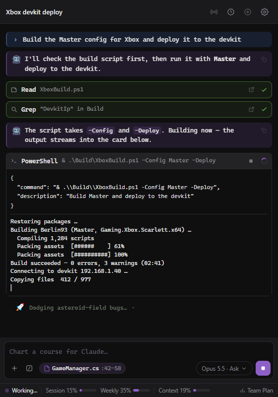

---

## Why Code Astrogator

Claude Code is great in a terminal. Inside an IDE you want more than a terminal: see what Claude changes,
decide what stays, and undo it when it goes wrong. That is what Code Astrogator is built around.

- **A real chat, not a console.** Rendered Markdown with tables and code blocks, tool cards with live
  console output, approval cards with a diff, clickable question cards. Everything Claude does is readable
  and clickable, nothing scrolls by as raw terminal text.
- **Review Claude's edits where you code.** Proposed edits show up *inline in the code editor*: deletions
  in red, additions as green lines, **accept or reject each hunk**. Or let Claude work uninterrupted and
  review every changed file at the end of the turn, while you already write the next prompt.
- **Rewind anything.** A checkpoint before every prompt. Roll back code, conversation or both, file by
  file, **including changes made by bash commands and scripts**. Your own git repository is never touched.
- **You stay in control.** Approve commands and MCP tools with one click, trust recurring ones with
  auto-approve patterns, stop a single runaway command without ending the turn. Background tasks such as
  a log capture keep running while you answer.
- **Continue on your phone.** Start Remote Control, scan the QR code, and continue the same chat from
  claude.ai or the Claude app. The panel updates live.
- **Your setup, unchanged.** Runs the official Claude Code CLI with your subscription or API key. Your
  CLAUDE.md, MCP servers, skills and permissions apply as usual. The extension never touches your
  credentials.

### Compared to Claude Code in a terminal

| | Claude Code in a terminal | Code Astrogator |
|---|---|---|
| Answers | Plain terminal text | Rendered Markdown, tables, code blocks with copy and insert-into-editor |
| An edit needs approval | A yes/no prompt | A diff card, or inline in the editor with accept/reject per hunk |
| After the turn | Run `git diff` yourself | A list of every changed file, keep or revert each change |
| Undo | Edits made by commands and scripts are not covered | Rewind file by file, commands and scripts included |
| A command hangs | Interrupting it interrupts the turn | A stop button on the command, the turn goes on |
| Where you look | A terminal next to your code | Your code: open files from any card, edits marked in the editor |

## Screenshots

### Review edits inline in the editor

Accept or reject each hunk where the code lives, with scrollbar marks and a jump-to-change toolbar.

  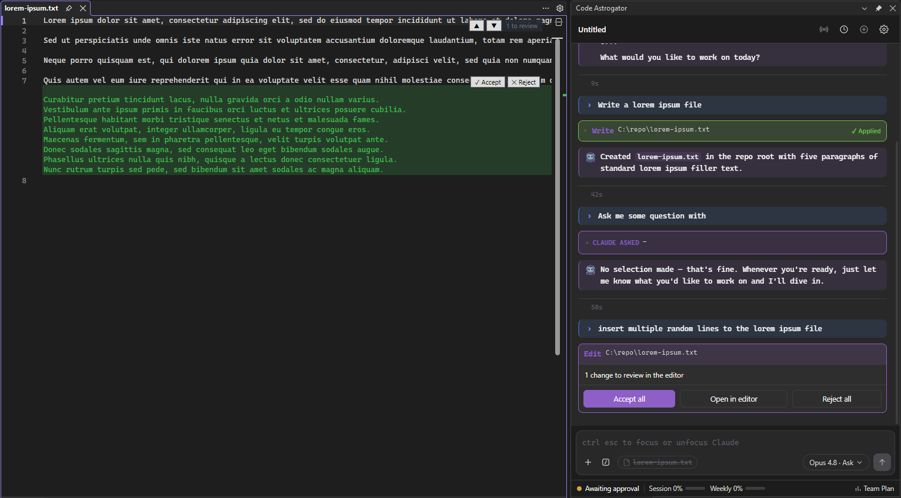

### Approve with a diff, or review everything at the end of the turn

  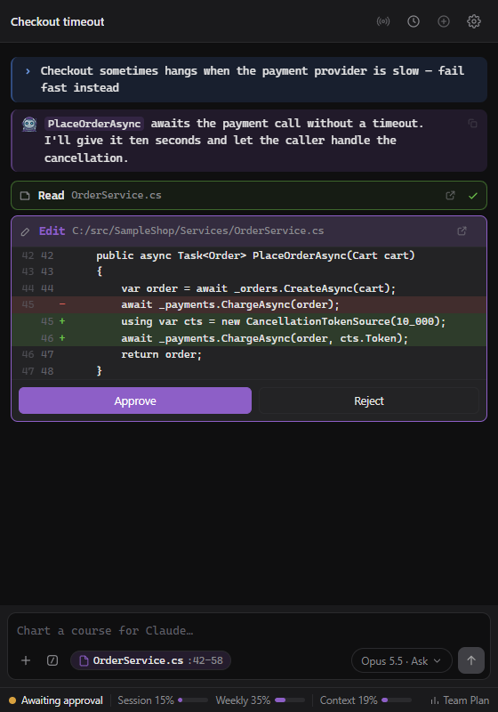
  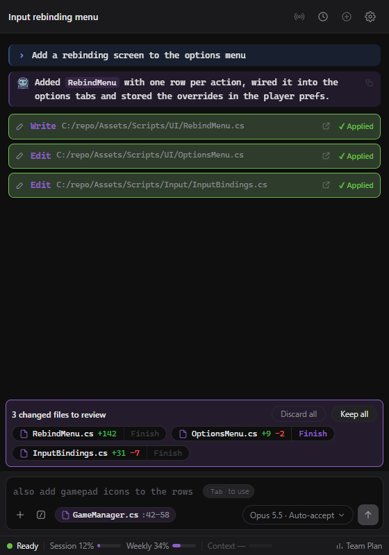

### Rewind and keep an eye on the context

Every prompt is a checkpoint: pick which files to roll back. The context meter shows how full the context
window is and what fills it, with a Compact button.

  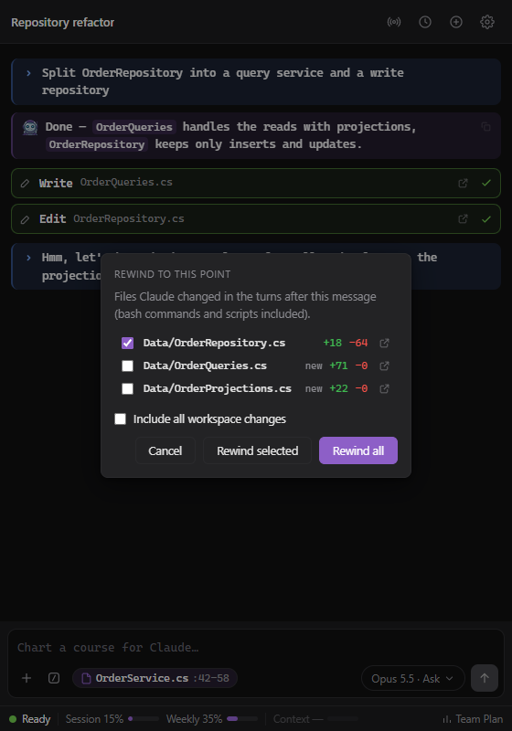
  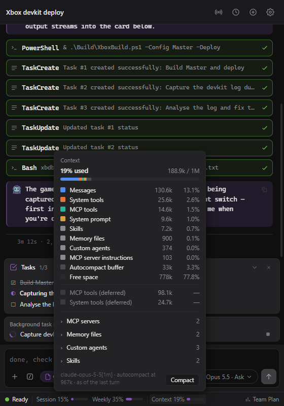

### Watch Claude work, and keep going while it runs

Commands stream their output live into the card (■ stops just that command). Long-running work like a log
capture keeps running in the background while you answer; tasks, background tasks and subagents are listed
above the input, and the footer shows duration, tokens and the cost of the turn.

  
  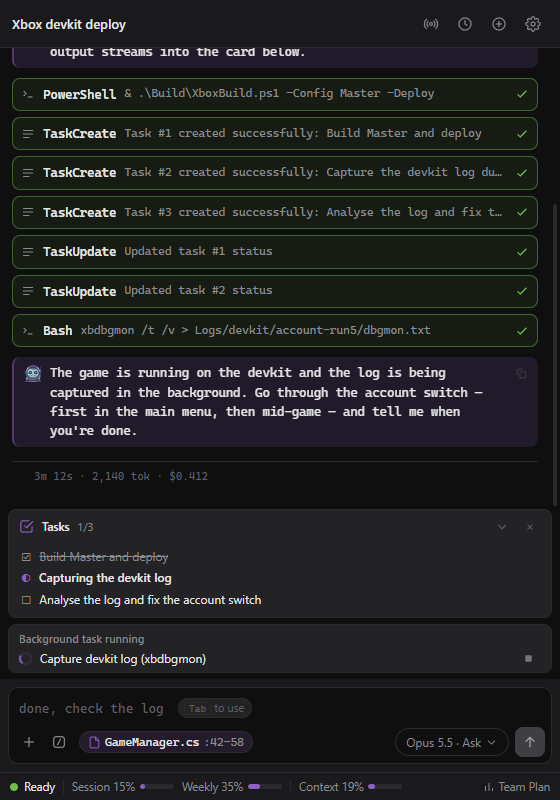

### Answer questions with a click

Claude's questions are clickable cards. Several at once are paged, with a ✓ on every answered tab.

  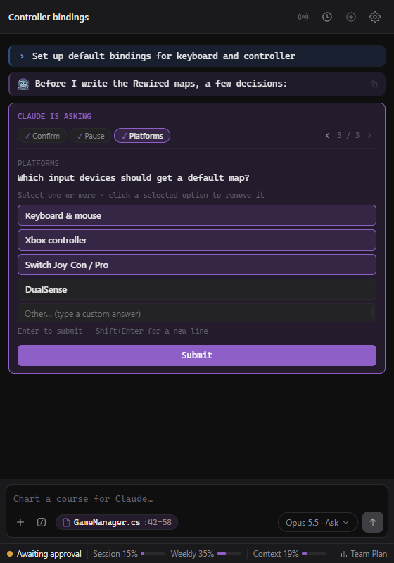

### Remote Control

Scan the code with your phone (or open the link at claude.ai/code) and continue the chat there. What
happens remotely shows up live in the panel.

  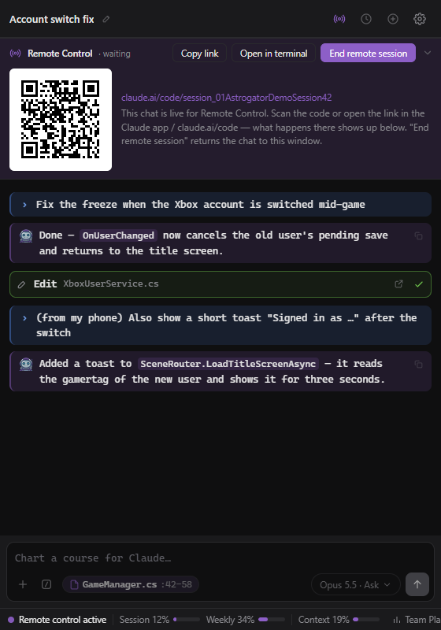

### Model, effort and permission mode

  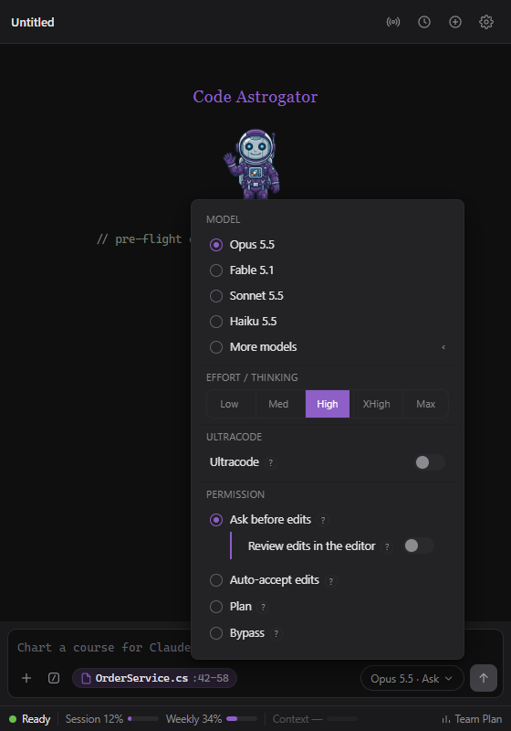
  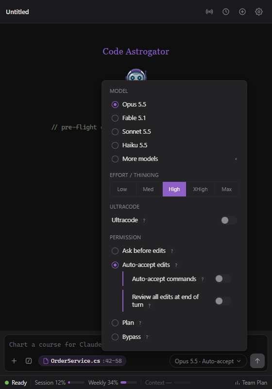

### Attach context and tune the look

  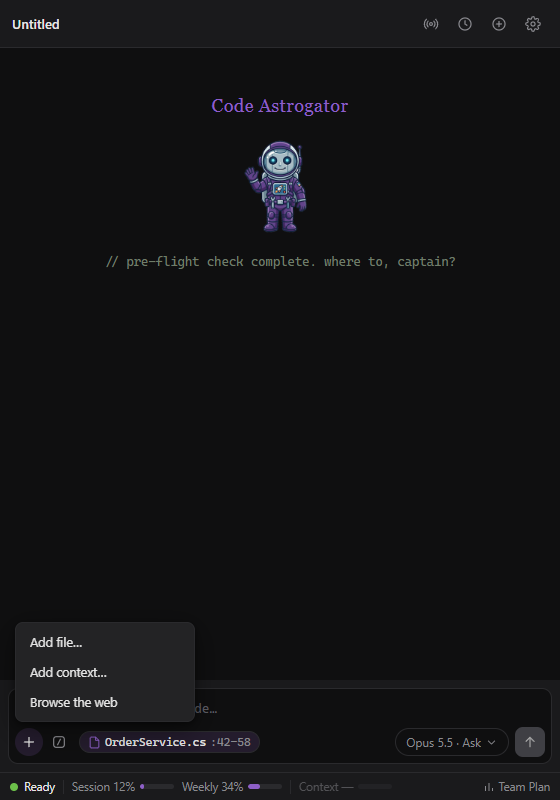
  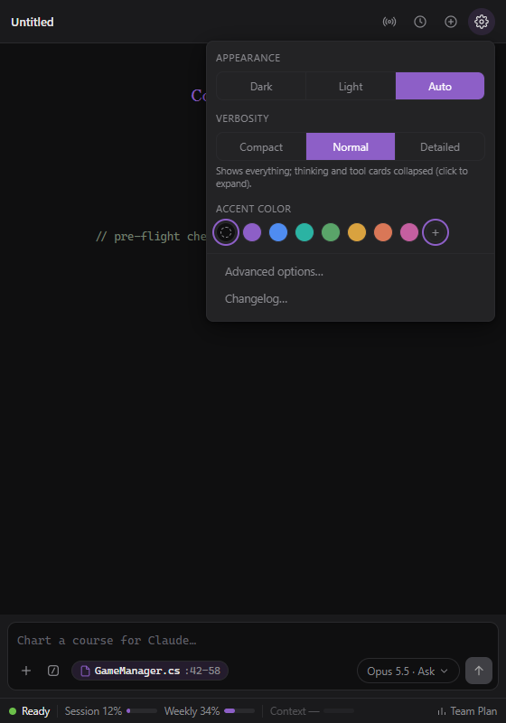

## All features

**Chat & tools**
- **Streaming chat** with Markdown (incl. tables), code blocks with copy / insert-into-editor,
  "Copy as Markdown", and extended-thinking cards.
- **Tool cards** for Read / Grep / Bash / PowerShell / Edit / Write / MCP tools, with an open-in-VS button
  and success/error tinting. Subagents show their report and an "Agent finished · time · tokens" line.
- **Live console**: Bash and PowerShell commands stream their output into the card while they run,
  progress bars included. A **■ stop button** ends just that command; **Stop** ends the turn and every
  command it started.
- **Background tasks don't block you**: when Claude starts a log capture or a dev server in the
  background, the turn is done as soon as Claude has answered. A bar above the input lists what still
  runs (with a stop button each); your next message goes to the same session, so the task keeps running.
- **Prompt suggestions**: after a turn Claude Code predicts your likely next prompt; press **Tab** to take
  it over.
- **Interactive questions**: Claude's questions appear as cards with clickable options and a free-text
  "Other"; several questions are paged one at a time.

**Approvals & review**
- **Permission cards**: approve or reject file edits and commands inline, with a syntax-highlighted diff.
  An "Always" button and an **auto-approve pattern list** let trusted commands / MCP tools run silently.
- **Inline edit review in the editor (opt-in)**: review proposed edits *directly in the code editor*: red
  for deletions, green phantom lines for additions, **Accept / Reject per hunk**, scrollbar marks and a
  jump-to-change toolbar.
- **Review all edits at end of turn (opt-in)**: in Auto-accept mode Claude works without interruptions;
  afterwards the changed files are listed for review (Keep / Revert per change, or Keep all / Discard all).
  You can keep prompting meanwhile; further changes join the same list.
- **Permission modes**: Ask / Auto-accept edits (optionally auto-accept commands too) / Plan / Bypass.

**Safety net**
- **Checkpoints**: a snapshot before every prompt; hover any message to **rewind** code, conversation or
  both, file by file. Changes made by bash commands and scripts are covered too; your own git repository is
  never touched. Large binaries and media are left out, so checkpoints stay small even in game projects.

**Remote Control**
- Continue the current chat **from your phone or claude.ai/code**: a QR code and link appear at the top of
  the panel, the conversation below updates live, and "End remote session" brings it back. No console
  window: Claude Code runs the session in the background, so it keeps running even if you close Visual
  Studio, and the chat picks up everything on the next start.

**Context & usage**
- **Context meter** with a breakdown like the Context panel in the Claude app (messages, tools, MCP,
  memory files, skills, …) and a **Compact** button.
- **Usage meters**: session and weekly limits with reset times and a plan badge.
- **Turn footer**: duration, tokens and the cost of that turn.

**Everything else**
- **Model · Mode popover**: model (newest of each family first, older ones under "More models"),
  effort (Low … Max), ultracode and permission mode; your choices persist. New Claude models appear without
  an extension update.
- **Context attachments**: `@`-mention autocomplete, drag-and-drop from Explorer, clipboard image/file
  paste (a screenshot alone is a valid prompt; several attachments sit side by side), web browsing, the
  active editor file with the selected lines, and editor right-click → "Add file / selection to prompt".
- **Session history** per workspace; conversations resume across VS restarts.
- **Theming**: Dark / Light / Auto (follows VS), an accent color, syntax themes for code (Visual Studio, GitHub, Monokai, Solarized), the color of your own messages and how strongly messages are tinted, color-blind friendly diffs (blue/orange), three verbosity levels, and the font and size for the UI and for code separately (Cascadia Code, Roboto, Arial, Times New Roman, or your own font files).
- **Automatic updates** (opt-in) from the GitHub releases, plus announcement banners.

## Requirements

- **Visual Studio 2026** or **Visual Studio 2022 (17.14 or later)**, Community, Professional or Enterprise.
  Developed and tested on Visual Studio 2026.
- The **[Claude Code CLI](https://docs.claude.com/en/docs/claude-code)** installed and on your `PATH`
  (or point to it in settings) and signed in:
  - **Subscription:** run `claude /login`.
  - **API key:** sign in with your Anthropic API key.
- A recent CLI is recommended. A few features need a newer one and simply stay off with an older CLI:
  prompt suggestions (2.1.28x+) and Remote Control without a console window (2.1.29x+; older versions open
  a console instead).

## Installation

1. Download the latest **`CodeAstrogator.vsix`** from the
   [**Releases**](https://github.com/finex7070/CodeAstrogator/releases) page.
2. **Close Visual Studio**, then double-click the `.vsix` to install (it over-installs any previous
   version).
3. Reopen Visual Studio and show the panel via **View → Other Windows → Code Astrogator**.

Later versions can install themselves: turn on automatic updates when the panel asks (or in the
settings), and a new release is installed the next time Visual Studio closes.

## Getting started

1. Make sure the Claude Code CLI is signed in (see [Requirements](#requirements)). If not, the panel
   shows a sign-in hint.
2. Type a prompt and press **Enter** (**Shift+Enter** for a new line). Attachments alone, e.g. a pasted
   screenshot, can be sent too.
3. When Claude wants to edit a file or run a command, an approval card appears: **Approve** or
   **Reject** (or switch to Auto-accept in **Model · Mode**).
4. Want to review edits in the editor instead? Turn on **inline edit review** or **Review all edits at
   end of turn** in the settings.
5. Use the toolbar to attach files (`+`), run slash commands (`/`), or change model and permission mode
   (**Model · Mode**). The broadcast icon in the header starts Remote Control, the clock opens the history.

The working directory of each turn is your open solution/folder, so Claude has your project context.

## Settings

Open settings via the **gear icon → "Advanced options…"**. Among others:

- The Claude CLI path (if it isn't on `PATH`), default model / effort, theme, and verbosity.
- Permission mode, the auto-approve pattern list, inline edit review and "Review all edits at end of turn".
- Checkpoints (on/off, what goes into a snapshot, retention) and chat-history retention.
- Prompt suggestions, prompt timeout, restore-last-session, auto-add active file / selected lines.
- Announcements, update notifications and automatic updates, and keeping the model list up to date from
  the project's GitHub, each with a "Check now" button.

Quick appearance options (theme, verbosity, accent color) are also available directly in the gear popover.

## Release notes

See [`CHANGELOG.md`](CHANGELOG.md) for the version history.

## License

GNU Affero General Public License v3.0 (AGPLv3)

This project is open-source and available under the AGPLv3 license.

✅ Commercial Use: You are free to use this extension for commercial work (e.g., in a paid development environment or for client projects).
✅ Modification: You are free to modify the code to suit your needs.
🔄 Copyleft: If you distribute a modified version — or make one available to others — you must release your modifications under the same AGPLv3 license. Closed-source proprietary forks are not allowed.

See the [LICENSE](LICENSE) file for full details.

The bundled Roboto font is licensed under the SIL Open Font License 1.1 (`WebUI/fonts/Roboto-OFL.txt`).

> "Claude" and "Claude Code" are products of Anthropic; this extension integrates the Claude Code CLI but is not affiliated with or endorsed by Anthropic.

---

> Made with ❤️ by Jan Hüls "finex7070" [StickyStoneStudio GmbH](https://www.stickystonestudio.com)
